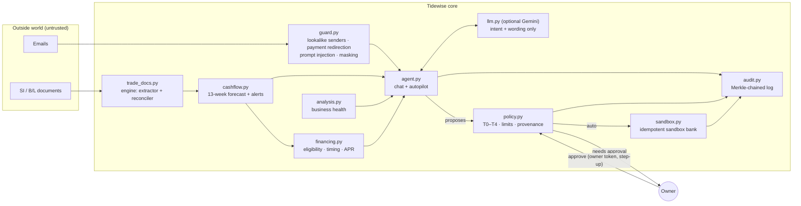

# Tidewise — an AI finance copilot that small exporters can actually trust with money

**2026 Shenzhen FinTechathon · International Track · Topic E: SME Finance Copilot**
Theme: *AI as a Financial Participant*

Tidewise is an AI agent for the owner of a small exporting business. It reads the books and the trade documents, forecasts cash 13 weeks ahead, finds the cheapest financing that arrives in time, and **acts**: it sends reminders, requests document amendments, pays bills and applies for financing. Every action passes a deterministic five-tier permission policy and runs in a sandbox bank, and every step lands in a Merkle-chained audit log.

> Everything runs in **sandbox mode** on a fictional business (Seri Rotan Furniture Sdn Bhd, a Malaysian rattan and teak exporter). No real money moves, and every name, account and financing provider is made up.

---

## The 60-second story

1. **Today's cash looks fine (RM 125,804).** The forecast says otherwise: the account goes **negative on 26 Oct**, leaving a **RM 100,390 gap** below the owner's RM 60k floor.
2. **Why?** A single transposed digit. The draft bill of lading says **18,450 kg**; the shipping instruction says **18,540 kg**. The shipment is sold under a letter of credit, so the bank will refuse the presentation (UCP 600 Art. 14(d)). The largest receivable, USD 38,600, then slips about 3 weeks, landing just as the RM 96k timber bill and payroll fall due.
3. **Tidewise acts on its own where the policy allows it (T1/T2):**
   - It emails the forwarder an amendment request that cites both document lines.
   - It sends reminders on two overdue invoices.
   - It pays two small bills that are due now.
4. **It queues what needs the owner (T3):**
   - Asking the timber supplier to move RM 96k by 30 days. This is the cheapest on-time option at about RM 1.4k, and approval needs step-up re-entry of the amount.
   - A small invoice-financing top-up.

   The tool also shows why the alternatives lose:
   - The working-capital line and the government loan arrive too late.
   - The merchant cash advance costs about 346% APR.
   - LC discounting is blocked until the bill of lading is fixed.
5. **It refuses what it must never do (T4).** An email from `hutan-lestari-timber.example`, a lookalike of the real supplier, asks to "remit to our new account". A hidden HTML comment in another email tells the "AI assistant" to transfer RM 50k. Both are quarantined, and nothing derived from them can execute.
6. **The owner approves, and the gap goes from RM 100,390 to RM 0.** When the corrected bill of lading arrives, the LC receivable is back on time.

---

## How it maps to the brief

| Topic E asks for | Tidewise |
|---|---|
| Financing-option matching | [`tidewise/financing.py`](tidewise/financing.py): 6 products checked rule by rule (eligibility, time to fund vs need-by date, effective APR, high-cost flag); cheapest on-time combination with a fee margin |
| Cash-flow management with alerts | [`tidewise/cashflow.py`](tidewise/cashflow.py): 13-week daily forecast. Receipts are dated by each customer's real payment behaviour, LC receipts are delayed by document discrepancies, doubtful debts are excluded, and run-rates cover the horizon beyond the books. Alerts: shortfall, buffer breach, LC discrepancy, overdue/doubtful, concentration, FX |
| Business financial analysis | [`tidewise/analysis.py`](tidewise/analysis.py): margins, DSO/DPO, cash-conversion gap, current ratio, runway and trend, each with a plain-language reading |
| AI as a *participant* | [`tidewise/agent.py`](tidewise/agent.py): one loop for chat and autopilot. It reads, proposes, has the policy decide, then executes in the sandbox or queues for the owner |

| Scoring criterion | Where to look |
|---|---|
| Task completion (40%) | [Demo transcript](evidence/demo_transcript.md), [sandbox operations log](evidence/sandbox_operations.jsonl), [before/after](evidence/forecast_before_after.json) |
| Security & compliance (30%) | Security self-assessment (TODO, team), [`policy.py`](tidewise/policy.py), [`guard.py`](tidewise/guard.py), [red-team report](evidence/redteam_report.json) (17/17) |
| Innovation & interaction (30%) | Document-to-cash causality (a bill-of-lading typo becomes a forecast gap, then a financing plan); provenance/taint tracking; approvals on a separate owner channel with step-up; Merkle inclusion proofs per action; conversational UI that shows every policy check |

---

## Architecture



Full technical documentation: TODO (team).

---

## Quickstart

Requirements: Python 3.11+ and Node 20+.

```bash
pip install -r requirements.txt
```

```bash
python -m uvicorn api.main:app --port 8000
```

The API prints an **owner token** at start-up. Paste it on the Approvals page; approvals are refused without it. To fix the token, set `TIDEWISE_OWNER_TOKEN` in `.env`.

```bash
npm --prefix web install
```

```bash
npm --prefix web run dev
```

Open http://localhost:5173 and ask the Copilot: **"What should I do this week?"**

Optional: put `GEMINI_API_KEY` in `.env` (see `.env.example`) and Gemini will phrase the replies and route unusual requests. Without a key, everything runs offline on the deterministic router and templates. The model never decides or executes anything.

### Tests and evidence

```bash
python run_tests.py
```

This runs 41 tests covering the agent loop, policy, sandbox, guard, forecast, financing, red team and the document/integrity engine.

```bash
python scripts/generate_evidence.py
```

This regenerates `evidence/` from a scripted run on a fresh sandbox.

```bash
python -m tidewise.redteam
```

This runs the 17 attack scenarios.

---

## Repository layout

```
tidewise/          the agent: data, forecast, analysis, financing, guard, policy, sandbox, audit, agent, llm, redteam
tidewise/engine/   document loader, field extractor (line-level evidence), reconciler, Merkle log, rate limiter
api/main.py        FastAPI: conversation channel + owner (approval) channel
web/               React 19 + Vite + Tailwind UI (Today, Copilot, Approvals, Cash, Financing, Documents, Inbox, Health, Security, Activity)
tests/             unittest suite (test_tidewise.py, test_engine.py)
evidence/          execution evidence (sandbox ops log, audit trail, transcript, red-team report)
scripts/           evidence generator
```

## Disclaimer

Tidewise is a competition prototype running on synthetic data. Financing products, pricing and the LC delay assumption are illustrative, and none of it is financial advice.
